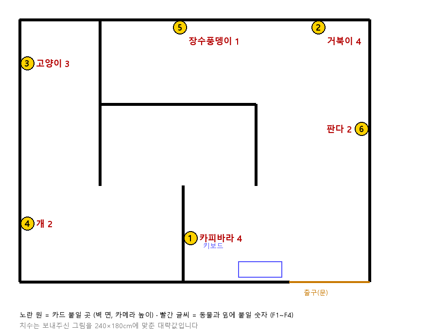

# 진행 기록 2026-11-22 — @higogo1

11/17~11/22 동안 로봇(라즈봇 V2)으로 시험하고 정한 내용을 한곳에 정리합니다.
코드와 측정값 자세한 내용: [`docs/04_implementation/exp_2026-11-22_keyboard_lidar_ble_hand.md`](../../04_implementation/exp_2026-11-22_keyboard_lidar_ble_hand.md)

## 한 일

### 1. 카메라 (11/17~)
- Camera Module 3: Pi 5 는 22핀 단자라 15핀 기본 케이블로는 안 됨, **부팅할 때만 인식** (꽂은 뒤 재부팅 필요). 가장 넓은 화각 = 센서 전체 모드(2304×1296 비닝, ScalerCrop 0,0,4608,2592). 자동초점 연속 모드.
- C270 웹캠: **고정 초점** (약 40cm 보다 가까우면 흐림), 줌 없음. 1280×720 은 4:3 센서(1280×960)의 위아래를 자른 것. 1280×960 이 최대 화각이지만 프레임이 약 14 → 7~10fps 로 떨어짐.
- 카메라 실시간 화면 + 주행 + 사진/녹화 웹 페이지를 개인 도구로 만들어 시험 (팀 저장소에는 올리지 않음).
- **모듈3 영상이 가끔 멈춤** (30분에 3번): `Camera frontend has timed out` 뒤 센서 I2C 쓰기 실패(`error -5`) → 센서와 연결이 순간적으로 끊김. 전원(전압 저하 기록 없음), 온도, 라이다·서보·웹캠 부하에서는 재현 안 됨 → **리본 케이블 접촉/당김이 가장 유력**. 한 번은 재부팅해야 돌아왔음.

### 2. 주행 (11/17)
- 바퀴 순서 0 왼앞, 1 왼뒤, 2 오른앞, 3 오른뒤 (메카넘). 바퀴 엔코더·IMU 없음 → 시간으로 움직임.
- 시험 동작 move1 (15cm 전진 ×2 → 오른쪽 180도 → 15cm 전진 ×2) 보정값 (속도 80):
  - 전진 약 50cm/s, 회전 약 197도/s (180도에 0.914초)
  - 직진 좌우 보정: 회전 전 -1%, 회전 후 +3% (같은 값에서도 쏠림 방향이 바뀌어서, 0.3초 짧은 동작은 출발 순간 미끄러짐 오차가 큼)
- 앞의 초음파 센서는 손이 가려서 항상 6.8cm 로 나옴 → 지금 상태로는 못 씀.

### 3. 라이다 (11/21~22)
- RPLIDAR A1M8: 측정 시작 후 첫 데이터까지 약 1.2초 걸림 (읽기 제한이 1초면 오판).
- 방 지도 그리기(스캔 맞추기, ICP)를 개인 도구로 만들어 시험: 시뮬레이션에서 1.2m 왕복 위치 오차 2cm, 한 바퀴 회전 방향 오차 0.2도.
- 11/22 팀 드라이버로 점검: 최대 약 4m 까지 잡힘 → "1m 만 잡힘" 재현 안 됨. 대신 **앞쪽 -60~+30도 응답률 0~50%, 손이 빔을 가리는 것으로 판단**.
- 3D 는 A1(2D 라이다) 하나로는 안 됨. 방법은 2D 지도 벽 세우기(2.5D), 카메라+깊이 추정 AI, 라이다 기울여 돌리기.

### 4. 미로·동물 카드 (11/22)
- 미로 **가로 240 × 세로 180cm**, 통로 약 64cm, 출구 **오른쪽 아래 가로벽**, 문은 안에서 **바깥으로 밀어 엶**.
- 동물 6종 흑백 사진(카피바라, 판다, 개, 고양이, 거북이, 장수풍뎅이), **옆에 숫자 1~4** 를 붙임. 처음에 찾을 동물을 정해 주면, 그 동물 옆 숫자를 기억했다가 마지막에 비밀번호로 누름.
- 무작위 배치 (같은 숫자 최대 2번, 미로 곳곳에 흩어지게):

| 번호 | 동물 | 숫자(키) | 붙일 위치 |
|---|---|---|---|
| 1 | 카피바라 | 4 (F4) | 아래 세로벽의 오른쪽 면 |
| 2 | 거북이 | 4 (F4) | 위쪽 바깥벽 오른쪽 |
| 3 | 고양이 | 3 (F3) | 왼쪽 바깥벽 위쪽 |
| 4 | 개 | 2 (F2) | 왼쪽 바깥벽 아래쪽 |
| 5 | 장수풍뎅이 | 1 (F1) | 위쪽 바깥벽 가운데 |
| 6 | 판다 | 2 (F2) | 오른쪽 바깥벽 가운데 |

### 5. 동물 + 숫자 인식 (11/22, 시작만 하고 보류)
- 지금 `vision.py` 의 YOLO(COCO)는 6종 중 **개·고양이만** 앎 (판다는 '곰'이 될 수도). 흑백 여부와 상관없이 4종은 못 찾음.
- 노트북 CPU(이 PC 에는 NVIDIA GPU 없음)로 시험, 위키백과 사진으로 만든 가짜 흑백 카드 52장:
  - 이름으로 찾는 YOLOE: 동물+숫자 정답 **14/52**, 엉뚱한 동물 다수
  - **숫자를 먼저 찾고(OCR) → 숫자 옆 사진을 잘라 6종 중 하나로 분류(CLIP)**: **36/52**, 짝 잘못 지음 **0번**, 장당 약 1.3초
  - 놓친 것은 대부분 사진 속 동물이 작거나 카드가 화면 밖에 걸린 경우. 실제 인쇄 카드로 다시 재야 함.

### 6. 키패드·문·손 (11/22)
- 키패드 = **키보드 F1~F4** (한 손에 들어옴), **바닥에 놓고** 손가락으로 누름. 문 옆 우드락 판에 구멍을 내 키 부분만 보이게.
- 무선 키보드는 **노트북**에 꽂고, 노트북이 정답을 판정해 피코에 "열어"를 보냄 (피코에 무선 키보드를 직접 붙이는 건 MicroPython 이 USB 호스트를 지원하지 않아 어려움).
- 손가락: 검지=F4, 중지=F3, 약지=F2, 새끼=F1. 누를 때는 **손을 다 편 상태에서 한 손가락만** 굽혔다가 다시 폄.
- 손(micro:bit)은 **블루투스**로. 새 프로그램을 블루투스로 올리고 누름 각도 실측 (검지 89, 중지 68, 약지 78, 새끼 74).
- 앞바퀴 앞 → 키 누르는 손끝 **21cm**. 손이 라이다보다 앞으로 튀어나와 있어 벽에 부딪힐 수 있음.

## 결과
- 키보드 F1~F4 입력, 블루투스 손 조종·누름 각도는 동작 확인.
- 라이다는 멀리까지 잘 잡히지만 **앞쪽이 손에 가려짐**.
- 동물 6종 인식은 지금 코드(YOLO)로는 안 되고, 숫자 먼저 찾는 방식이 가능성 있음 (실제 카드로 재확인 필요).

## 문제점
- 라이다 앞쪽 가려짐 → 앞 벽을 못 보고 부딪힐 수 있음
- 키보드가 바닥에 있어 라이다로 위치를 못 잡음
- 새끼(F1)가 손 각도 때문에 덜 눌림
- 모듈3 리본 케이블 접촉 불량 의심 (가끔 영상 끊김)
- 동물 인식이 CPU 에서 장당 1.3초 → "3초 안에 3번 보면 확정" 규칙에 빠듯함

## 다음 할 일
- 라이다를 손보다 높이 올리고 `lidar_check.py` + 정면 50cm 상자로 재확인
- 키보드를 출구 옆 구석에 벽 기준으로 고정 → 벽 두 개 거리로 멈추고 손 밑 카메라로 마지막 정렬
- 실측: 라이다 중심 → 앞바퀴 앞, 회전 중심 → 손끝, 손 포함 차 폭, 키보드 → 벽 거리
- 정렬을 조금 왼쪽으로 (새끼 F1) 하는 값 찾기
- 피코 WH 에 문 코드 올리기, 문 미는 서보 각도
- 실제 인쇄한 동물 카드를 C270 으로 찍어 인식 시험 (RTX 3060 노트북이면 더 빠름)
- 모듈3 케이블 다시 꽂고 고정, 손 밑으로 옮길 때 긴 케이블

## 관련 이슈·PR
-
