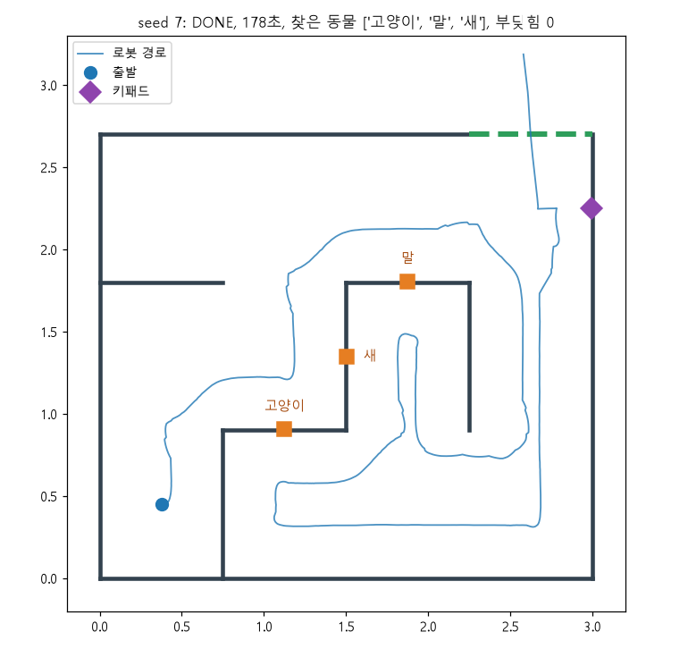

# 길잡이 미로 탈출 미션 코드

시나리오: 로봇이 라이다로 미로를 돌아다니며 벽에 붙은 동물 그림(고양이, 강아지, 새, 말)을 카메라로 찾는다.
다 찾으면 출구 옆 키패드로 가서, 찾은 동물에 맞는 숫자를 손가락으로 누른다. 맞으면 피코 WH가 서보로 문을 열고, 로봇은 문 마커를 따라 밖으로 나간다.



## 무엇이 어디서 도나

| 장치 | 파일 | 하는 일 |
|---|---|---|
| 라즈베리파이 (로봇) | `mission.py` + `lidar.py` `drive.py` `vision.py` `hand.py` | 라이다, 바퀴, 카메라, 손(micro:bit USB) 전부 |
| 라즈베리파이 | `lidar_view.py` | 라이다 실시간 화면 (필터 없음). 라이다 이상할 때 |
| 노트북 | `door_station.py` | 무선키보드 수신기를 꽂는 곳. 비밀번호 확인 후 피코에 "열어" |
| 노트북 (선택) | `vision_server.py` | 파이에서 YOLO가 느리면 노트북 GPU로 동물 찾기 |
| 피코 WH | `pico_door/main.py` | 와이파이로 신호 받아 서보로 문 열기 (+ 초음파) |
| 노트북 | `mission.py run --sim` | 로봇 없이 전체 흐름 시뮬레이션 |

## 미션 흐름

```
EXPLORE  라이다로 오른쪽 벽 따라가기 (몸을 벽 쪽으로 30도 돌린 채 옆으로 비스듬히 이동 -> 카메라가 옆 벽을 봄)
         + 7초마다 옆 벽 쪽으로 돌아서 보기 (LOOK)
         같은 동물을 3초 안에 3번 보면 "찾음" 확정
APPROACH 동물 3개 다 찾았고 키패드 마커(ArUco 0)가 보이면 -> 마커를 가운데로 -> 벽과 직각 -> 거리 press_dist 까지
PRESS    비밀번호 = 찾은 동물의 숫자 (기본: 작은 숫자부터). 숫자마다 맡은 손가락으로 누름
         문 스테이션이 "틀림"이라고 하면 다시 정렬해서 최대 3번
FIND_DOOR 뒤로 조금 물러나 제자리 회전하며 문 마커(ArUco 1) 찾기
GO_DOOR  문 마커 쪽으로 가서 통과. 앞이 막혀 있으면(문 아직 닫힘) 15초 기다림
TO_EXIT  (문 마커를 못 찾으면) 벽 따라가며 출구 찾기, 90초 지나면 반대 손으로
DONE     앞쪽이 1.2m 넘게 비면 밖으로 나간 것
```

## 시뮬레이션 결과 (노트북, 로봇 없이)

- 미로: 실제 바닥처럼 3.0 x 2.7m, 4 x 3칸, 고리 없는 미로를 무작위로 만듦
- 일부러 넣은 오차: 바퀴 속도 ±12%, 회전 ±15%, 직진할 때 휘어짐, 카메라가 20% 못 봄, 2% 잘못 봄
- 결과:

| 설정 | 미로 1~20 | 새 미로 21~40 |
|---|---|---|
| 몸 정면 + 7초마다 옆 보기 | 18/20 (못 본 카드 2) | - |
| 몸 정면, 옆 보기 없음 | 5/20 | - |
| **몸 30도 + 7초마다 옆 보기 (기본값)** | **20/20, 평균 300초, 부딪힘 0** | **20/20, 평균 352초** |

시뮬은 실제와 다르다. 특히 바퀴 미끄러짐, 라이다 잡음, 카메라 인식률은 현장 값으로 다시 맞춰야 한다.

## 현장에서 꼭 맞출 값 (config.json)

`config.example.json`을 `config.json`으로 복사해서 바꿀 값만 적는다. 안 적은 값은 `common.py`의 기본값을 쓴다.

| 값 | 어떻게 재나 |
|---|---|
| `lidar.front_offset_deg` | `python3 mission.py lidar` 실행 후 상자를 로봇 정면에 두고 "앞" 값이 줄어드는지. 아니면 `lidar_view.py`로 각도를 보고 적기 |
| `lidar.ignore` | 손이 레이저를 가리는 각도. 예: `[[-20, 20]]` (가까운 점만 버리려면 `min_range`를 키우기) |
| `drive.speed_fwd`, `speed_side` | 팀 `car.py calib fwd`, `car.py calib left` |
| `drive.speed_rot_deg` | `python3 mission.py calib-rot` |
| `mission.press_dist` | 손끝이 키 바로 위에 올 때 라이다 중심에서 키패드 벽까지 거리 |
| `mission.cam_offset` | 마커가 화면 가운데일 때 손가락이 키에서 옆으로 어긋나면 조정 |
| `hand.press_angle` | `python3 mission.py keys --sweep 2` (손가락 2~5 하나씩) |
| `hand.key_finger` | 어느 숫자 키 위에 어느 손가락이 오는지 |

## 내일 순서 (하나씩 통과하면 다음)

1. **라이다 원인 확인:** 라이다 쓰는 다른 프로그램을 끄고 `python3 lidar_view.py`, 폰으로 `http://<파이IP>:8080`
2. **라이다 방향:** `python3 mission.py lidar`
3. **회전 속도:** `python3 mission.py calib-rot`
4. **벽 따라가기만:** `python3 mission.py wall --secs 60` (처음엔 config에서 `wall.v` 를 0.10으로 낮게)
5. **카메라만:** `python3 mission.py see` (동물 사진과 마커를 카메라에 대 보기, `logs/see_*.jpg` 확인)
6. **손 누르기:** `python3 mission.py keys --sweep 3`, 그다음 `python3 mission.py keys --code 124`
7. **문:** 피코에 `pico_door/main.py` 저장 → 노트북에서 `python door_station.py --code 124 --pico http://<피코IP>`
8. **손 없이 전체:** `python3 mission.py run --virtual-press`
9. **전체:** `python3 mission.py run`

급할 때는 Ctrl+C. 바퀴가 멈추고 손이 펴진다.

## 준비물과 규칙

- **미로는 고리가 없어야 한다.** 벽 따라가기는 모든 벽이 바깥 벽에 이어져 있을 때 미로 전체를 돈다. 가운데 떠 있는 섬 벽이 있으면 그 둘레의 카드를 못 볼 수 있다.
- **동물 그림:** YOLO가 아는 동물만 된다 (cat, dog, bird, horse, sheep, cow, elephant, bear, zebra, giraffe). 그림보다 **실제 사진**이 잘 된다. 카메라 높이에 붙이기. 크기는 A5 이상.
- **마커:** `tools/make_markers.py`로 ArUco 0번(키패드 위), 1번(문틀 위, 문이 열려도 안 움직이는 곳) 인쇄.
- **키패드:** 키 4개(1~4)가 손가락 4개(검지~새끼) 아래에 오게. 키 간격이 손가락 간격(약 22mm)과 다르면 쓰는 키만 보이게 구멍을 뚫고 위치를 맞추기.
- **비밀번호 규칙:** 기본은 "찾은 동물 숫자를 작은 순서로" (예: 고양이1, 말4, 새3 → 134). 문 스테이션 `--code` 도 같은 규칙으로 정한다. 찾은 순서대로(`found_order`)는 문 스테이션이 정답을 미리 알 수 없어서 기본값이 아니다.

## 설치 (라즈베리파이)

```
pip3 install pyserial opencv-python ultralytics      # ultralytics 는 파이에서 YOLO 돌릴 때만
```
- `Raspbot_Lib`: 라즈봇 기본 이미지에 있음
- micro:bit: `microbit-serial-range.hex` 가 올라가 있어야 함, 파이 USB에 연결
- 파이에서 YOLO가 느리면 노트북에서 `vision_server.py` 를 켜고 config에 `"detect": {"mode": "remote", "url": "http://<노트북IP>:8090/detect"}`

## 아직 실제 로봇에서 안 해 본 것

이 코드는 시뮬레이션과 노트북 단독 시험(문 스테이션, 동물 찾기 서버)까지만 확인했다. 실제 라즈봇, 라이다, 손, 피코에서는 아직 한 번도 안 돌렸다.
